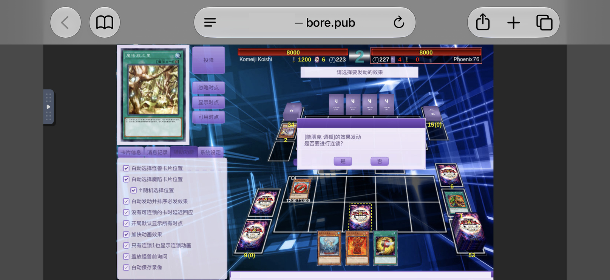
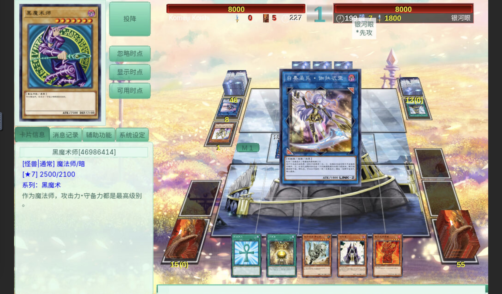
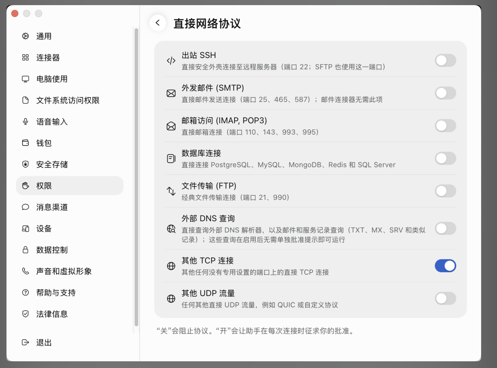

**iPhone、iPad 上也能玩免费原版游戏王 YGO 联网游戏**——手机浏览器打开一个链接就能打，不用装 App。



# KoishiPro Linux 远程游玩

在 Muse 免费配置的云电脑（Linux 系统，没有显示器）上安装 KoishiPro（游戏王全卡模拟器，YGOPro 衍生版），并通过浏览器远程游玩：手机或电脑打开一个网页链接就能打牌，不用在服务器跟前。

> 这份文档记录的是一次真实搭建的完整过程，包括踩过的坑（中文按钮空白、中文卡组选不了、隧道被拒、云电脑重启后全灭）以及对应的解法。按顺序照着做即可。

## 目录

- [1. 注册 Muse 账号并开启 other TCP](#1-注册-muse-账号并开启-other-tcp)
- [2. 在 Muse 云电脑 Linux 系统里下载游戏并安装](#2-在-muse-云电脑-linux-系统里下载游戏并安装)
- [3. 导入卡组并设为默认](#3-导入卡组并设为默认)
- [4. 关键修复：必须用 UTF-8 locale 启动](#4-关键修复必须用-utf-8-locale-启动)
- [5. 远程桌面：浏览器里看到游戏画面](#5-远程桌面浏览器里看到游戏画面)
- [6. 公开隧道：让手机浏览器能打开](#6-公开隧道让手机浏览器能打开)
- [7. 开始游玩](#7-开始游玩)
- [8. 云电脑重启后重建](#8-云电脑重启后重建)
- [9. 断开与安全](#9-断开与安全)
- [10. 排错](#10-排错)

---

## 1. 注册 Muse 账号并开启 other TCP

本项目跑在 Muse 免费配置的云电脑（Linux 系统）上。开始之前先做好这两步：

1. **注册一个 Muse 账号**（muse.ai），登录后会得到一台免费的云电脑。
2. **开启游戏联网需要的网络权限**，否则游戏连不上联机服务器：
   - 打开 Muse 设置 → Permissions（Manage permissions）→ Direct network protocols
   - 找到 `other TCP` 这一行，勾选 / 允许 `other TCP`

   

   上图：`其他 TCP 连接` 这一行开关已打开（蓝色）。

> 这一步要在下载游戏之前做。实测：如果不开，游戏内点「加入游戏」会报「无法连接到主机」。注意：系统层面的端口探测可能给出假的「通」的结果（被运行时拦截器应答后关闭），不要被它误导，以游戏内实际加入为准。

---

## 2. 在 Muse 云电脑 Linux 系统里下载游戏并安装

下面的命令都在 Muse 云电脑的 Linux 终端里执行。

**不要走萌卡（MyCard）客户端里的「安装 YGOPro」。** 萌卡在 Linux 上给的只是卡图、脚本和卡组，没有可执行文件，装完打不开。直接装 KoishiPro 官方的 Linux 包。

### 环境要求

- Linux x86_64，GLIBC ≥ 2.28（可用 `ldd --version` 查看）
- 约 1.5GB 磁盘空间

### 下载

```bash
mkdir -p ~/koishipro-download && cd ~/koishipro-download
curl -L -o KoishiPro-master-linux-zh-CN.tar.gz \
  https://cdntx.moecube.com/koishipro/archive/KoishiPro-master-linux-zh-CN.tar.gz
```

包约 1.2GB。如果网络慢、中途断掉，用断点续传接着下，不用从头来：

```bash
curl -C - -L -o KoishiPro-master-linux-zh-CN.tar.gz \
  https://cdntx.moecube.com/koishipro/archive/KoishiPro-master-linux-zh-CN.tar.gz
```

> 实测：首次下载很慢（几十 KB/s），中途断过一次，断点续传多试几次能下完。

### 解压并验证

```bash
tar xzf KoishiPro-master-linux-zh-CN.tar.gz -C ~/
cd ~/KoishiPro
ls ygopro cards.cdb deck/ pics/ script/ system.conf servers.conf
file ygopro   # 应显示 ELF 64-bit x86-64
ldd ygopro    # 确认没有 not found 的库
```

`servers.conf` 里已预置联机服务器，包括 Koishi 主服和 233 服（`s1.ygo233.com:233`）。这些是公开的联机服务器地址，改 `servers.conf` 可增减。

### 启动（先看第 4 节，必须用 UTF-8 locale）

```bash
cd ~/KoishiPro
LC_ALL=C.utf8 LANG=C.utf8 ./ygopro
```

用 `scripts/start.sh` 启动（已写好 locale，见下）。

---

## 3. 导入卡组并设为默认

把 `.ydk` 卡组文件放进 `deck/` 目录：

```bash
cp 你的卡组.ydk ~/KoishiPro/deck/
```

设为默认卡组：**要在游戏没运行时改**，因为游戏退出时会把当前配置写回 `system.conf`，覆盖你的修改。编辑 `~/KoishiPro/system.conf`：

```ini
lastcategory = 未分类卡组
lastdeck = 你的卡组名（不含 .ydk 后缀）
```

例如卡组文件是 `deck/禁止特招261005.ydk`，就写 `lastdeck = 禁止特招261005`。

> 卡组里的卡必须都在 `cards.cdb` 中存在，否则对局里会报错。导入前可用脚本核对一遍卡密。

---

## 4. 关键修复：必须用 UTF-8 locale 启动

这是本次搭建最关键的一课，单独列出来。

### 症状

- 游戏界面所有中文按钮、标签、列表都显示为空白（英文正常，聊天消息里的中文正常）。
- 卡组下拉列表里只有英文名卡组，中文名卡组根本不出现，点「准备」报「无效卡组。」（`strings.conf` 1406），中文卡组选不了。

### 排查过程（走过的弯路）

- 查过 `strings.conf`：字串都在，`!system 1200 联机模式` 等无缺失。
- 试过关皮肤（`skin_index = 0`）、换系统字体（Noto Sans CJK）：均无效，按钮仍空白。
- 查过源码：按钮文字、卡组列表都是正常创建的，问题不在界面代码。

### 根因

**启动环境的 locale 是 POSIX/C（`LC_CTYPE="POSIX"`，`LANG` 为空）。** 在这个 locale 下，UTF-8 文件名和字串转宽字符失败，导致两个后果同时出现：

1. 界面中文无法渲染（字串解码错了，字体找不到对应字形）。
2. 目录遍历时中文名 `.ydk` 文件转换失败，卡组下拉列表里根本没有中文卡组。

### 修复

用 UTF-8 locale 启动游戏：

```bash
LC_ALL=C.utf8 LANG=C.utf8 ./ygopro
```

并用 `scripts/start.sh` 启动（见仓库 `scripts/`）。修复后按钮、房间信息、卡组名全部正常显示中文，中文卡组也能正常选中。

> 检查当前 locale：`locale`。若没有可用的 UTF-8 locale，先装一个（例如 Debian/Ubuntu 的 `locales` 包，生成 `C.utf8` 或 `en_US.UTF-8`）。

---

## 5. 远程桌面：浏览器里看到游戏画面

服务器没有显示器，游戏跑在虚拟显示上，再把画面通过 VNC + 网页暴露出来。

### 安全原则（先读这段）

远程桌面默认必须有密码，网页也只能从本机进。不要用无密码 + 公网监听的写法：

- **VNC 必须输密码。** 不要用 `-SecurityTypes None`。无密码时，任何拿到隧道链接的人都能直接操作桌面，随机端口本身没有身份验证。
- **noVNC 只监听本机 `127.0.0.1:6080`，不监听 `0.0.0.0:6080`。** 这样网页只能经 bore 隧道进来，不会直接暴露在云电脑的公网网卡上。

### 结构

```
游戏 (Xvnc :99) → VNC 5900（密码认证） → websockify 127.0.0.1:6080 → bore 隧道 → 浏览器 noVNC 页面
```

### 先设 VNC 密码

用仓库的 `scripts/set-vnc-password.sh` 生成密码文件（`~/.vnc/passwd`，权限 600，只存加密后的密码，不存明文）：

```bash
# 交互式输入两次密码（推荐，自己定一个好记的）
bash scripts/set-vnc-password.sh

# 或生成一个随机 8 位密码并打印出来
bash scripts/set-vnc-password.sh --random
```

密码文件生成用的是系统自带的 `vncpasswd`（`tightvncpasswd` 或 `tigervnc-tools` 提供）。没有会自动尝试安装；装不上就报错退出，绝不悄悄回退到无密码。

### 虚拟显示 + VNC

用 TigerVNC 的 `Xvnc` 同时做 X 服务器和 VNC 服务器（也可以用 Xvfb + x11vnc，效果一样）：

```bash
Xvnc :99 -geometry 1024x640 -depth 24 -rfbport 5900 -rfbauth ~/.vnc/passwd -SecurityTypes VncAuth
```

然后在该显示上启动游戏（务必带 UTF-8 locale）：

```bash
DISPLAY=:99 LC_ALL=C.utf8 LANG=C.utf8 ./ygopro
```

### 网页客户端

用 websockify + noVNC 把 VNC 转成网页。**只绑本机 `127.0.0.1`，不要写 `0.0.0.0`：**

```bash
# 安装 websockify（pip）
pip install websockify

# 下载 noVNC（任选一个版本）
curl -L -o novnc.tar.gz https://github.com/novnc/noVNC/archive/refs/tags/v1.5.0.tar.gz
tar xzf novnc.tar.gz && mv noVNC-1.5.0 novnc

# 启动（只监听本机）
python3 -m websockify --web=./novnc 127.0.0.1:6080 127.0.0.1:5900
```

此时本机打开 `http://127.0.0.1:6080/vnc.html` 应能看到游戏画面（会先提示输入 VNC 密码）。但这只是本机地址，手机打不开，需要第 6 节的公开隧道。

---

## 6. 公开隧道：让手机浏览器能打开

### 为什么不用 Cloudflare 快速隧道

试过两次，均被拒（`quick tunnel provisioning failed with status 403`）。改用 bore。

### bore + 本地中继

[bore](https://github.com/ekzhang/bore)（v0.6.0）能把本地端口暴露成一个公开链接，形如 `http://bore.pub:<随机端口>/vnc.html`。

但 bore 自身的 socket 在某些沙箱/受限网络里连不上 bore 服务器，而普通 Python socket 可以。解法是在本机跑一个透明 TCP 中继，让 bore 连中继，中继再连 bore 服务器：

```
bore --to 127.0.0.1:7835 → 中继 /tmp/relay.py (127.0.0.1:7835) → bore.pub:7835
```

中继脚本见仓库 `scripts/relay.py`，启动：

```bash
python3 scripts/relay.py &
./bore local 6080 --to 127.0.0.1
```

bore 启动后会打印分配到的公开端口，例如：

```
listening at 127.0.0.1:<随机端口>
```

对应的公开链接就是：

```
http://bore.pub:<随机端口>/vnc.html?autoconnect=true&resize=scale
```

> 每次启动 bore，端口都会变。把链接发给要玩的人之前，先 `curl` 验证一下能返回 200。

---

## 7. 开始游玩

1. 打开公开链接（手机或电脑浏览器均可），点「连接」，输入 VNC 密码（`scripts/set-vnc-password.sh` 设的那个），输对才能进入游戏画面。
2. 主菜单自上而下：联机模式 / 单人模式 / 录像回放 / 卡组编辑 / 退出。
3. 点「联机模式」→ 在联机界面选服务器（233 服等）→ 点「加入游戏」进房。
4. 进房后先确认卡组下拉框里是你想用的卡组，再点「准备」；房主点「开始」后开局。
5. 开局先猜拳（剪刀/石头/布），赢的人选先攻或后攻。

### 233 服房间小提示

- 房间不等人：房主久不开始会被服务器踢出（有 15 秒倒计时警告），进房后尽快准备。
- 房间里人来人往很正常，对手可能随时退出，退了就重新进房。

---

## 8. 云电脑重启后重建

**虚拟机随时可能重启，重启后上面所有进程（Xvnc、游戏、websockify、中继、bore）都会死，公开链接失效。** 但游戏本体、卡组和配置都在 home 目录里，不会丢。

重建顺序（仓库 `scripts/setup-remote.sh` 已把下面几步写成一键脚本）：

```bash
# 1. 虚拟显示 + VNC（密码认证，见第 5 节；不要用 -SecurityTypes None）
Xvnc :99 -geometry 1024x640 -depth 24 -rfbport 5900 -rfbauth ~/.vnc/passwd -SecurityTypes VncAuth

# 2. 游戏（带 UTF-8 locale，见第 4 节）
DISPLAY=:99 LC_ALL=C.utf8 LANG=C.utf8 ./ygopro

# 3. 网页客户端（只监听本机 127.0.0.1，不监听 0.0.0.0）
python3 -m websockify --web=./novnc 127.0.0.1:6080 127.0.0.1:5900

# 4. 中继 + 隧道
python3 scripts/relay.py &
./bore local 6080 --to 127.0.0.1
# 从 bore 输出里取新端口，拼出新链接，curl 验证 200 后再发给人
```

> 注意：`/tmp` 下的文件（例如中继脚本、VNC 密码文件）重启后会被清空，不要把重要文件只放在 `/tmp` 里。

---

## 9. 断开与安全

- **用完就断。** 玩完后按顺序停掉：bore、中继、websockify、Xvnc、游戏。链接失效后别人就进不来了。
- **不要长期挂着公开链接。** 隧道链接是公开可访问的，即使有 VNC 密码，也不要长期挂着；密码和链接都不要发到公开场合。
- **VNC 密码文件 `~/.vnc/passwd` 会留下来复用**（权限 600，只存加密后的密码）。想换密码就再跑一次 `bash scripts/set-vnc-password.sh`，然后重启 Xvnc。
- **不要把真实 IP、密码、真实隧道链接写进公开仓库或发到公开场合。** 本仓库只写方法与占位符，不含任何真实地址、密码和访问链接。
- **不要用 `pkill -f <带空格的命令>` 杀进程。** 如果命令字符串里恰好出现目标进程名，会把执行命令的 shell 自己也杀掉。杀 websockify 要用 `pkill -f "websockif[y]"` 这类写法，且整条命令里不能再出现目标词本身。

---

## 10. 排错

| 现象 | 原因 / 解法 |
|---|---|
| 按钮中文空白、中文卡组选不了、点「准备」报「无效卡组。」 | locale 是 POSIX/C。改用 `LC_ALL=C.utf8 LANG=C.utf8` 启动（见第 4 节） |
| 游戏内「加入游戏」报无法连接到主机 | 出站 TCP 被沙箱/防火墙拦截。检查运行环境的网络权限设置，允许游戏的出站连接；重试一次（首次连接可能因授权超时失败，授权通过后重试即可） |
| Cloudflare 快速隧道 403 | 换 bore（见第 6 节） |
| bore 连不上 bore 服务器 | bore 自身 socket 在受限网络下超时。用 `scripts/relay.py` 本地中继（见第 6 节） |
| 打开链接显示 noVNC 但报 `Authentication failure` | VNC 密码不对，或触发了 VNC 的 IP 黑名单（多次输错密码会封 IP）。重新设密码：`bash scripts/set-vnc-password.sh`，再重启 Xvnc；也可以重启 VNC 服务清掉黑名单。**不要用 `-SecurityTypes None` 绕过**——那等于把桌面公开给任何拿到链接的人 |
| 重启后链接打不开 | 虚拟机重启会杀掉全部进程，按第 8 节重建 |
| 端口已被占用 | 上一次的进程没杀干净，用 `ss -tlnp` 查看并杀掉残留进程再启动 |

---

## 许可

MIT License。KoishiPro 本体及其卡片数据归原作者所有，本仓库只记录搭建方法与脚本。
